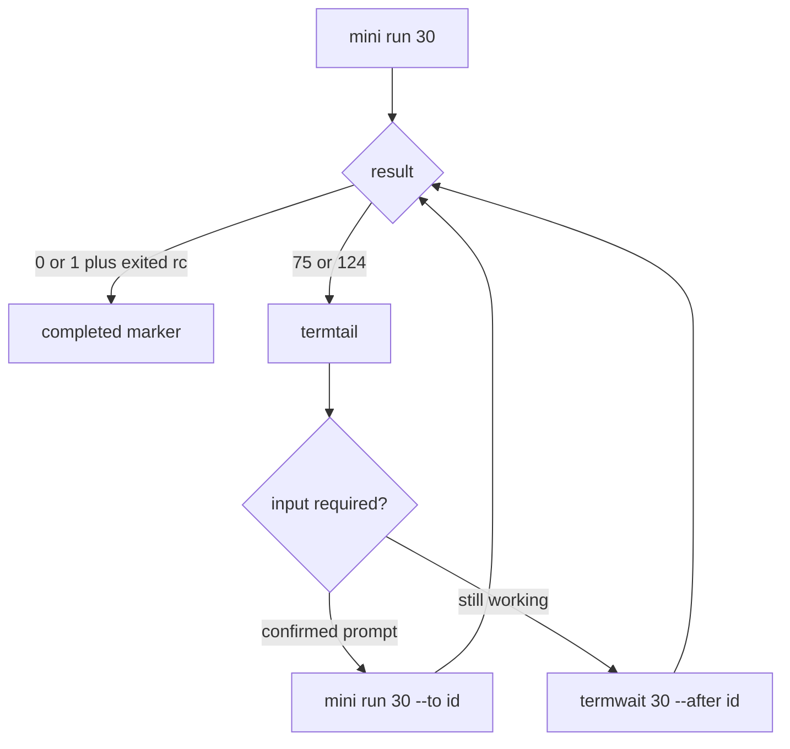

# mini-op

Docs and scripts that set up and drive a Mac mini for live tests. A project's
own test runbooks and mini-side scripts live in that project's `.mini-op/runbooks/`
(ensemble's: `windroc-labs/ensemble`), found by `/mini-op:run`.

Private repo. It holds no secrets: passwords, API keys and tokens live in the
mini's login keychain, and the scripts read them from there.

## Start here

Read this README whole before touching anything: rules, driving the mini, gotchas. Then the runbook for
the task. Each fact has one home; the others point to it.

| File | Covers |
| --- | --- |
| `README.md` › Rules, Driving the mini, Gotchas | what you must and must not do; screen, clicks, typing, the browser, waiting and answering; read before debugging |
| `status.md` | one-off records: the current environment and where the work stopped |
| `runbooks/setup-test-env.md` | machine access, browser install, reconnecting mini-op after a reset |
| `runbooks/return-mini.md` | erasing the mini before it goes back |
| `runbooks/check-connection.md` | the read-only check that mini-op reaches the mini and the mini's `~/apm` is in sync |
| `runbooks/visible-operations.md` | every mini-side operation: visible route, protected exceptions and result recovery |
| `host/README.md` | the mini-op container that operates the mini, and its environment definition for ensemble |

## Layout

Files sit by where they run.

| Path | What it is |
| --- | --- |
| `status.md`, `runbooks/` | current records and the procedures (Start here), each runbook opening with a frontmatter `when:` line, the only part `/mini-op:run`'s lookup reads |
| `mini/` | runs on the mini, copied there as `~/apm/` by `ctl/mini sync` (`host/README.md`, Deploy to the mini), which keeps the mini's runtime state in `~/apm/state/`: `bin/` basic operations, `ts/` the JXA programs' TypeScript and `ts/page/` the page programs' (the code `o eval` runs in a page), `js/` and `js/page/` the programs `tsc` builds from them (committed, never edited by hand), `lib/chord.applescript` the one AppleScript program (held-modifier chords), `lib/secrets.zsh` the one list of secret patterns, `lib/opencli.zsh` the one parser of OpenCLI's replies (`opencli_data`) and the page-program caller (`page_js`), `lib/keychain.zsh` the one keychain reader (`keychain_read`, `keychain_has`; runbook steps and project scripts source it too); on the mini they run as `~/apm/bin/<name>` |
| `ctl/` | runs in the mini-op container (baked into the image's plugin root, on its `PATH`) or on this Mac; `ctl/lib/secrets.zsh` names the secrets dir; `ctl/CLAUDE.md` is the container operator's routing table and hard rules; `ctl/runbook` is `/mini-op:run`'s runbook lookup (Scripts) |
| `plugin/` | the mini-op plugin, baked into the mini-op image under `/opt/windroc/plugins/mini-op/`: `plugin/.claude-plugin/plugin.json` its manifest, `plugin/skills/run/SKILL.md` its skill `/mini-op:run`; listed as `mini-op` in marketplace `windroc` (`windroc-labs/agent-plugins-marketplace`): installing it needs access to `windroc/mini-op`, and it works only in the mini-op image |
| `host/` | runs on this Mac: the mini-op container and its proxy, `update` (hands a project's runbooks to the direct-use container), and `config.yaml` (every setting's default; the mini's address and account empty) with `config`, which merges `~/.mini-op/config.local.yaml` onto it and generates the ssh and proxy configs into `~/.mini-op/` (`host/README.md`) |
| `tests/`, `.github/`, `.githooks/` | offline tests, CI and the optional pre-commit hook (Offline checks) |

### Scripts

| Script | What it does |
| --- | --- |
| `mini/bin/ans [secs] [--to <id>]` | types stdin into the mini's Terminal plus Enter (a command with an exit-code marker; with `--to`, an answer to command `<id>` as is), scrolls to bottom, then runs `termwait` (Waiting and answering) |
| `mini/bin/termwait <secs> --after <id>` | marker proves completion; unchanged readable contents for 3 s returns 75 (look now, never completion); limit is 124; last lines redacted (Waiting and answering) |
| `mini/bin/termtail [N \| --all]` | read-only redacted Terminal tail (default 25 nonblank lines); --all reads the full snapshot; never types, activates or scrolls |
| `mini/js/keys.js [--enter] [--front Terminal\|Chrome\|SecurityAgent\|SettingsSheet] [--secret] [--verify-field] [--wake]` | JXA: types stdin as keystrokes, less one trailing newline; `--enter` adds Enter, `--front` types only into that app (Chrome: only while it is frontmost; SecurityAgent: its one focused secure field; SettingsSheet: System Settings frontmost with a focused secure field), `--verify-field` checks the field got every character and clicks Allow (SettingsSheet: OK), `--secret` keeps the text out of every message |
| `mini/js/click.js <x> <y>` | JXA: click at screen coordinates |
| `mini/js/terminal.js activate\|front\|history [--all]\|contents\|bottom`, `mini/js/chrome.js activate\|close <url-substring>\|hide\|auth` | JXA: Terminal (activate hides Chrome; bottom is Cmd+End); Chrome hide verifies it is hidden; auth consumes a trusted page program on stdin, never a token argv, and fails safely unless one Linear tab and JavaScript from Apple Events are available |
| `mini/bin/dialogs [click <button>]` | lists on-screen windows with buttons, or presses the named button (`mini/js/dialogs.js`) |
| `mini/bin/front <url-substring>` | brings the Chrome tab whose URL matches to the front (`mini/js/front.js`); exits 1 when none matches |
| `mini/bin/o` | foreground wrapper for `opencli browser` (e.g. `role`, `mail`); `--private` hides Chrome and selects background for secret-bearing pages; window placement is automatic; caller `--window` options are unsupported |
| `mini/bin/secfield <session> <css>` | masks the field, real-clicks it and verifies focus and password type before typing stdin; prints no secret |
| `mini/bin/shot [out.png]` | screenshots the mini, refused while a Terminal window holds a secret (a pattern in `mini/lib/secrets.zsh`) or cannot be read |
| `ctl/mini sync [--check]` | run on this Mac or in mini-op: copy `mini/` to the mini's `~/apm/` with its `VERSION` stamp, keeping `~/apm/state/`; `--check` exits 1 unless the mini's `~/apm/VERSION` matches |
| `host/update <checkout>` | on this Mac: snapshots the checkout's `.mini-op/runbooks/` into the direct-use container's workspace, regular files only (`host/README.md`, Hand over a project) |
| `ctl/runbook list\|path <name> [--project <name>] [--workspace <dir>]` | in mini-op: `/mini-op:run`'s runbook lookup, the current project's runbooks before the plugin's; details: `ctl/runbook -h` |
| `ctl/runbook deploy <name> [--project <name>] [--workspace <dir>]` | in mini-op: puts a project runbook's scripts on the mini; details: `ctl/runbook -h` |
| `ctl/mini exec [secs]`, `mini exec --collect <id>` | public noninteractive stdin runs through `mini/bin/visible` in Terminal; returns complete separate stdout/stderr and original status 0–255; a timeout retains a private job for collect, which never executes it again (`runbooks/visible-operations.md`) |
| `ctl/mini run [secs] [--to <id>]` | run on this Mac or in mini-op: types stdin into the mini's Terminal with `~/apm/bin/ans` and waits (Waiting and answering); not for secrets: use mini pw |
| `ctl/mini chord <mods> <key code>` | run on this Mac or in mini-op: a held-modifier chord (`mini/lib/chord.applescript`) into the mini's front Terminal |
| `ctl/mini pw [--lock \| --sa \| --settings]` | mini-op only: types the mini's password from `/run/secrets/mini-password` (Rules) into the mini's front Terminal, the lock screen (`--lock`), the SecurityAgent dialog (`--sa`: clicks Allow, only when its one secure field is focused) or a System Settings password sheet (`--settings`: clicks OK, only while System Settings is frontmost with a focused secure field) |
| `ctl/mini sudo <command> [args]`, `ctl/mini sudo -v` | mini-op only: runs a command with sudo on the mini, the password from `/run/secrets/mini-password`; `-v` checks the password only |
| `ctl/mini-autologin [--reboot]` | mini-op only: as root (sudo, the mini's password from `/run/secrets/mini-password` on stdin) re-enables the account's auto-login: writes `/etc/kcpassword` itself (the public XOR encoding, by stock `perl`; mode 600, root:wheel), as `sysadminctl -autologin set` cannot over ssh, and sets `autoLoginUser` to the account; it fails unless the file was rewritten (new inode, mtime and size) and `autoLoginUser` is the account; `--reboot`, only at the login window: then reboots and waits up to 300 s for the account to be the console user (exit 124 if the mini does not come back) |
| `mini/bin/linearlogin [--code] <email>` | logs the Linear tab out, requests a login mail for the email, follows its link or, with `--code`, enters its login code |
| `mini/bin/maillink mark\|follow\|code <email>` | remembers the Linear mails in Outlook's Inbox and Junk Email, then opens a new one's link, or types its login code into the Linear tab, without printing either |

## Rules

- **Visible first:** every mini-side operation that can safely be watched over VNC runs in its visible Terminal or browser. Public noninteractive commands use `mini exec`, interactive commands use `mini run`, ordinary pages use `o` (enforces `--window foreground`). SSH carries input/results and drives GUI helpers; execute public work there only for the specific exceptions in `runbooks/visible-operations.md`. Attach the target tmux pane in Terminal before sending work to it.
- Secrets move only machine to machine by pipe or redirect: `ssh mini '<reads stdin>' < /run/secrets/mini-password`. Never in argv, env, logs or output.
- Secrets also never appear on screen, in window titles or shell history. Keep credential reads/writes, authentication mail and secret-producing pages in protected pipes/files or `o --private` (hides Chrome and uses `--window background`). A private browser reply may contain a secret: consume it in a pipe or 0600 file. Leave the secret page before restoring foreground. Page secrets use only `secfield`, which masks the field and verifies focus; Terminal secrets require a confirmed no-echo prompt. Do not send secrets to `exec`, `run` as a new command, shell variables exported to the environment, or tmux send-keys. If an external tool cannot isolate secret output before it appears, stop that step. For an installer's tty auth phases, hand control to the user before launch and resume only after the user finishes and clears secret text and scrollback.
- The mini's address and account are `mini_host` and `mini_user` in `~/.mini-op/config.local.yaml` on this Mac, never in this repo (`host/README.md`, Steps); docs write the account as `<mini_user>`. Its password is only in mini-op's `/run/secrets/mini-password`, which the user types in after every container start (`host/README.md` step 4), or in an ensemble environment's `/run/ensemble/secrets/env/mini-password`, which `ctl/` reads first when it exists. While mini-op is stopped, the user types it at the mini's prompt. Without either file (a fresh container start, or this Mac) `mini pw` and `mini sudo` exit 1 and send nothing: ask the user to write it.
- Run nothing that installs developer tools on the mini: it has no python3, and calling it pops the Command Line Tools installer. Install scripts must start from this blank state.
- The user does every human check (CAPTCHA, press-and-hold). On the mini the no-defeating-bot-detection rule does not apply (the user, 2026-10-21): e.g. human-like timing jitter in typed input is fine.
- Long waits (email delivery) run as background commands on this Mac.
- **Never move or resize a window on the mini** (no Terminal size or font change): the user sizes the VNC window and arranges them (the user, 2026-10-21).
- From the mini-op container, only Claude and the mini's ssh (`ssh`, `scp`) get out (`host/README.md`, Network): fetch anything else on the mini over ssh.
- Scripts do the fixed, mechanical parts (mail lookup, login); the manager drives the website steps with OpenCLI, reading each page before acting, so a changed page is noticed instead of clicked through.
- Read pages with OpenCLI (`eval`, `state`, `wait`); screenshots only for what is outside a page (lock screen, Chrome or macOS dialogs).

- macOS dialogs (Rosetta, keychain, local network, folder access) are read and clicked with `~/apm/bin/dialogs` (`dialogs` lists each window's buttons; `dialogs click "Don’t Allow"` presses one), not screenshots. A screenshot is the last resort, for a window with no named buttons, and never while a secret is on screen.

## Driving the mini

From this Mac, `ssh mini` and `scp` to `mini:` need `-F ~/.mini-op/ssh_config` (`host/config` generates it); in mini-op they work as written.

Use `printf '%s\n' '<public command>' | mini exec 60` for noninteractive work; full stdout/stderr and its original rc return without scraping the screen. A 124 names `mini exec --collect <id>`: collect, never rerun an uncertain command. Details and exceptions: `runbooks/visible-operations.md`. For interactive programs use Waiting and answering below.

Outside a page: screenshots only with `~/apm/bin/shot`, scp back, then `sips -Z 1440` (image pixels = points on the 880x1440 display); clicks `osascript -l JavaScript ~/apm/js/click.js X Y`; public typing with `keys.js --enter` (without `--enter`, no Enter).

### Browser

1. Keep one Chrome window: OpenCLI's own, holding session `role` (Linear) and session `mail` (Outlook, opened with `o open … --session mail`). Close any other window.
2. Drive ordinary pages with `~/apm/bin/o <command> --session <name>` (foreground is enforced), after `~/apm/bin/front <url part>` raises the safe tab; wait with `o wait text|selector …`, not `sleep`. Authentication mail and secret-producing steps use `--private`; never raise them to fix a rendering failure. The private mail-link exchange uses Chrome's existing View › Developer › Allow JavaScript from Apple Events permission (the user enables it); without it, follow fails safely. `--code` uses the masked secfield route.
3. A React field that stays empty after `o type`: click it with `click.js` and type with `keys.js`.

### Waiting and answering

During an interactive install, wait **at most 30 s at a time**, then read `~/apm/bin/termtail [N]` (default 25 nonblank lines, redacted). Never wait 240–600 s through a prompt. Start a public interactive command with `printf '%s\n' '<cmd>' | mini run 30`; on the mini, `ans 30` does the same. Public noninteractive work needing complete stdout/stderr uses `mini exec` instead.

`ans` types a command wrapped to write its exit status atomically to `~/apm/state/done/<id>` (`<id>.tmp` then rename). **Only that marker proves completion.** `termwait <secs> --after <id>` checks it and reads full redacted Terminal contents: three seconds unchanged returns **75**, a “look now” signal, including for a quiet command still doing work. Prompt text never proves completion. Read failures do not count as idle. 0 means the marker held 0; 1 means a nonzero/malformed marker or failure; 124 means the wait limit was reached. Each wait result attempts a redacted tail; read failures print a diagnostic. 75/124 keep the command pending; only a completed marker is consumed. Markers older than a day are cleaned up.


The signal never authorizes an automatic answer; inspect the actual prompt first.

Answer a running command with `printf '%s' '<public answer>' | mini run 30 --to <id>`. `--to` types it as is plus Enter, scrolls to the bottom, then uses the same idle signal, so an unchanged hidden answer returns after a few seconds. A fresh `run` adds a command marker and must only be used at a shell prompt. Passwords/keys reach a confirmed no-echo prompt only by protected stdin (`mini pw` for the account password); page secrets use secfield. Never type a secret merely because 75 was returned.

`ans` refuses before typing unless Terminal is frontmost. New commands require their text to land within 5 s; typing has a 15 s bound and other Terminal calls a 5 s bound. A launch/read/scroll timeout returns 124, naming the id when the command may have started: keep that id and inspect instead of resending. A scroll timeout after waiting preserves the wait's status. `mini run` preserves 0/1/75/124, maps SSH failure/other unexpected statuses to 1, and asks for `mini sync` if the timeout helper is absent. `termtail` is read-only; it never activates, scrolls or types. More result and connection recovery: `runbooks/visible-operations.md`.

## Gotchas

A project's own gotchas (for ensemble: Outlook, GitHub, Linear, Strata and OpenCode, sbx, its install and broker) are in its `.mini-op/runbooks/`.

- **The mini's keychain locks in every new ssh session.** Reads fail with `User interaction is not allowed` (rc 36), writes with -25308. Unlock it in the same session before each use: `printf 'unlock-keychain -p "%s" login.keychain\n' "$P" | security -i`.
- **OpenCLI acts only on a visible tab.** Clicks and typing on a covered tab fail with "Native input requires a visible browser page" or `semantic_not_found`; a Linear page in a covered window stays on "Loading…"; Outlook renders no message list in a hidden tab, so a read finds an empty inbox. Keep one window and raise the tab with `~/apm/bin/front` first: with two windows, `front` can raise the wrong window's tab of the same site.
- **A stale "install command line developer tools" dialog.** Calling `python3` over ssh before the tools exist opens that dialog and it stays up for hours, even after Homebrew installs the tools. Never call `python3` on a blank mini; if the dialog shows, check `xcode-select -p` and click Cancel.
- **Terminal does not take focus from Chrome.** `tell application "Terminal" to activate` leaves Chrome frontmost, so typed answers land in Chrome. Hide Chrome first.
- **Terminal reads can leak secrets.** Public exec results are complete and unfiltered; its command and output must both be public. Read interactive Terminal prompts only through `termwait`. Its redaction is a second barrier, not permission to display a secret first.
- **The Terminal view does not follow the output.** The window stayed scrolled at an old line while `install.sh` waited at `Write it? [y/N]`, so it looked stuck in a progress bar. Trust `termwait`'s text, not the window, and scroll the window to the bottom after each answer.
- **Reading the screen missed completions.** Prompt patterns, exit lines and line-count baselines each missed a case (a repeated prompt, an exit line before the wait, output ending in blank lines before the shell prompt waited out the limit, 2026-10-23), so only the command's marker proves completion; an idle 75 ends the current wait solely to request inspection (Waiting and answering).
- **A Terminal screenshot shows the setup token.** The broker step prints the Claude setup token on screen; a screenshot taken for the keychain dialog after it captured the whole token. After the token step, clear the scrollback (Cmd+K) before any screenshot, and fill the keychain dialog by its fixed position (password field 512,422, Allow 590,465) without one.
- **`do script ""` presses Enter.** Sending an empty `do script` to the Terminal tab answers whatever prompt is open with an empty line (it emptied the OpenCode key once). Use `ans` for every answer and nothing else.
- **A rejected or killed ssh command keeps running on the mini.** Closing this Mac's ssh does not end the remote shell: on 2026-10-21 a rejected command went on sending `do script` and `get contents` to Terminal while new commands did the same, and Terminal stopped answering Apple Events (no crash or hang report; cause not proven). After a rejection run `pgrep -fl 'zsh -c'` and `pgrep -x osascript` on the mini and kill the leftovers; only one command drives Terminal at a time; wrap Terminal `osascript` calls in `with_timeout 8 osascript …` (after `. ~/apm/lib/timeout.zsh`, from `mini/lib/timeout.zsh`; rc 124: kill osascript, restart Terminal).
- **No `python3` in `~/apm` scripts.** A clean mini has no Command Line Tools: any call to `python3` opens their install dialog (Cancel it). `secfield` parses OpenCLI's JSON with `sed` since 2026-10-23.
- **Never type a secret by OS keystrokes after only an OpenCLI (CDP) click.** A CDP click does not move macOS keyboard focus out of Chrome's address bar: on 2026-10-21 the GitHub password went into the omnibox and out as a Google search, and the account password had to be changed. Type secrets with `~/apm/bin/secfield <session> <css>` (secret on stdin): it real-clicks the field, checks `document.hasFocus()` and the active element, and types nothing otherwise.
- **Screenshots of the mini only through `~/apm/bin/shot`**: it refuses while a Terminal window holds a secret (a pattern in `mini/lib/secrets.zsh`) or cannot be read. install.sh's Claude Code login leaves the full setup-token on screen; a raw `screencapture` there put it in my transcript on 2026-10-21.
- **Every key chord on the mini: hold the modifier(s), press and release the key, then release the modifier(s) last** (the user, 2026-10-21): `tell application "System Events"` / `key down command` / `delay 0.2` / `key code 9` / `delay 0.2` / `key up command` for Cmd-V; the same for Ctrl-C (`key down control` … `key code 8` … `key up control`). In the Terminal: `ctl/mini chord <mods> <key code>` from this Mac (e.g. `mini chord command 40` clears it, `mini chord control 8` interrupts). JXA's `keyDown("command")` sends nothing useful: use AppleScript's `key down command`. Never a one-shot `keystroke … using … down`: GitHub's device-code boxes got Cmd-V that way as a typed "v", and the code landed one box to the right. Pasting: real click on the field, Escape (closes Chrome's autofill list), then the held Cmd-V. Set the clipboard on the mini with `printf '%s' … | pbcopy`.
- **System Settings password prompts are not SecurityAgent** (macOS 26+). A sheet in System Settings asks (e.g. Software Update), so `mini pw --sa` says "no SecurityAgent; typed nothing". Use `mini pw --settings`: it types only while System Settings is frontmost with a focused secure field, checks the field got every character, then clicks OK.
- **A locked screen eats keystrokes.** The mini's screen locks: screenshots come back all black, `ioreg -n Root -d1 -a` shows `CGSSessionScreenIsLocked` true, and keystrokes never reach Terminal while `mini pw` still reports "sent". Check for a lock before trusting a "sent". Unlock with mini-op's `mini pw --lock` (wakes the display, presses Shift, types the password from `/run/secrets/mini-password`, reports "unlocked" or "still locked"), check with `~/apm/bin/shot`, then run `nohup caffeinate -dimsu -t 28800 &` on the mini so it stays unlocked through long runs. It ends after 8 hours: restart it before each long session.
- **The mini can stop at the login window.** With no one logged in (`stat -f%Su /dev/console` prints `root`) nothing reaches a Terminal, and the login window's selected user and focus cannot be checked, so never type there. On 2026-10-24 a reboot alone did not help: auto-login had broken (`/etc/kcpassword` was gone). Run mini-op's `mini-autologin --reboot`: it restores auto-login as root, reboots and waits for the account; if it fails, stop and ask the user to log it in (Screen Sharing: `runbooks/setup-test-env.md` 1.4).

## Offline checks

Run from this repo with node (the version in `.node-version`), zsh, bash, tar and shasum. CI runs
each line as is:

```sh
npm ci --ignore-scripts
.github/tools install
npm run lint
npm run format
npm run typecheck
npm run guards
npm test
npm run coverage
```

- `.github/tools install` puts the pinned shellcheck, shfmt, actionlint and typos (`.github/tools.tsv`, each checked by sha256) in `.tools/`; lint, format and their tests need them. CI installs zsh from Ubuntu's archive, unpinned.
- `npm run lint`: every shell file by its shebang (`zsh -n`; `bash -n` and shellcheck), actionlint, typos. `npm run format`: prettier for TS, shfmt for bash, bash lines within 100 columns; `npm run format:write` fixes what it can. `npm run typecheck`: `tsc` strict, then `.github/jxa.ts`, which builds each JXA entry in `mini/ts/` on its own with `mini/ts/jxa.d.ts` and fails unless `mini/js/` holds exactly that output; `npm run jxa:write` rewrites `mini/js/`. `npm run guards`: the repository rules in `tests/guards/`, each tested on a violation and a clean sample. Among them: no Python file or call, JS only as `.github/jxa.ts` builds it into `mini/js/`, comments at most 15% of the source's and 10% of the tests' non-blank chars (plus 500; usage text goes in the `-h` string), and no block of 6 code lines shared by two files unless registered with its reason in `tests/registry/duplicates.json`.
- `npm test` runs every `*.test.ts` under `tests/`. Scripts under test run in a sandbox (`tests/lib/sandbox.ts`): their PATH holds only fakes and allowlisted tools, so `ssh`, `scp`, `osascript`, `security`, `docker`, `curl`, the clipboard, `screencapture`, `tmux` and `opencli` are never real; `HOME` and the secrets dir are temp dirs. Fakes match `osascript` by program file name and arguments, never by program text. The JXA entries' tests (`tests/mini/ts/`) run each entry's source in node against fake JXA globals (`tests/lib/jxa.ts`). The host tests likewise fake `docker` by argv prefix. No test connects to the mini, sends Apple Events, uses a running container or reads credentials.
- Secrets: `tests/lib/canary.test.ts` runs every script that reads a secret (`tests/lib/canary.ts`) with fakes feeding it a canary, and fails if it appears anywhere but its final consumer's stdin; real tools run behind shims logging argv/env. Necessary variable reads are registered in `tests/registry/secret-reads.json`. There is no secret argv exception: maillink feeds its private authentication program to Chrome JXA on stdin, consumes the link by same-origin fetch, and only navigates a safe final path.
- Every script and program entry (`mini/`, `ctl/`, `host/`, `.github/`, `.githooks/`, and the JXA entries in `mini/ts/`, which `mini/js/` is built from) has its test at `tests/<path without a leading period or code extension>.test.ts`, asserting exits 0, 1, 2 (and 124 when it can time out; a JXA entry 0 and 1, as osascript exits 1 on any thrown error); `tests/registry/untested.json`, the list of scripts without one, stays empty. The help probe (`tests/lib/help_probe.test.ts`) runs every script with `-h` (exit 0, usage on stdout starting with its name, no stdin read, command run or file written) and with an unknown option (exit 2, stderr starting `<name>: `), but those the sandbox's tripwire (`tests/lib/tripwire.ts`) refuses: registered secrets readers, and registered PATH bypasses that put a dir ahead of PATH (`mini/bin/o` only appends opencli's dirs, so it runs). Shipped files that are not code are listed with their covering tests in `tests/registry/non-code.json`. osascript runs only a `mini/js` program or a file listed in `tests/registry/applescript.json`, never `-e` or stdin, and shell strings embed no osascript program or page JS: page JS is a page program in `mini/ts/page/`, built to `mini/js/page/` and called with `page_js` (`mini/lib/opencli.zsh`), its arguments JSON strings.
- `npm run coverage` runs the suite again with node's TS coverage and the sandbox's shell line trace (zsh and bash DEBUG traps, written to their own fd), then fails unless every managed script ran and 85% of the TS lines and branches and of the shell statements changed since `origin/main` (CI: the PR's base, else the commit the push followed; a push that creates its branch has none, so every line counts) are covered. Commit first: untracked files are not in the diff.
- The host tests (`tests/host/`) also run under bash 3.2.57, built in CI from GNU's tarball, as macOS's `/bin/bash`.
- CI's Image job is the one check that builds the image. When an image input changed (`.github/image-check changed`) and weekly, it builds `host/Dockerfile`'s `image` target with this checkout's stamp (`.github/image-check build`; no `host/start`, proxy or mini, so no mini address), checks its history for secrets and for a copied-in mini ssh config or host key (`history`), then prints a PASS/FAIL table from containers without a network (`smoke`): Claude Code runs, no python3 or sudo, user `agent` non-root, npm and node, the plugin root's `plugin.json` version is the stamp, no `windroc.` or `ensemble.` label, nothing of the plugin under `/home/agent`, `ctl/mini -h` under the ensemble layer's `PATH` from `/tmp`, ssh, zsh, jq and nc, no `mini.conf` or `mini_known_hosts`. Any FAIL fails the job naming its row. Otherwise it reports "No build needed (无需构建)".
- Optional: `git config core.hooksPath .githooks` makes each commit format its staged bash and TS files with the pinned versions.

For changing mini-op's files on the user's Mac, see [host/README.md](host/README.md#change-or-remove).
