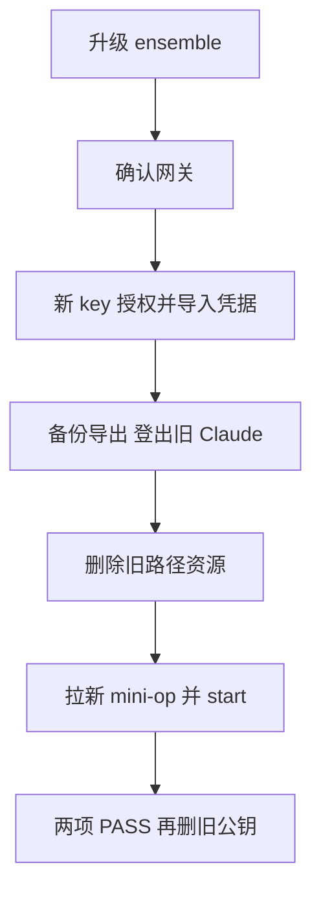

# mini-op

Direct use and `verifier` share `mini-op:env`. `host/start` builds it, then calls `ensemble-delegate open mini-op --environment mini-op --client claude --cwd ~/.mini-op/workspace`. The broker takes the `mini-op` lock, locates the healthy gateway by label, attaches its caller network and injects credentials. mini-op owns no container lifecycle, network, lock or stored credentials.

| What | Contract |
| --- | --- |
| Image | `mini-op:env`, built locally and never pushed; Debian, Claude Code, git, tmux, ssh, nc, jq, zsh, Node.js and npm; user `agent`, uid/gid 1000, no sudo or python3 |
| Runtime | `/opt/windroc/mini-op/`: `ctl/`, `mini/`, README, runbooks and plain skill; `/home/agent` is empty in the image |
| Skill | `mini-op`, installed at `/etc/claude-code/.claude/skills/mini-op/`; rules at `/opt/windroc/mini-op/CLAUDE.md` |
| Session | `mini-op`, host cwd `~/.mini-op/workspace`, workspace volume `ensemble-ws-mini-op`; `host/start` creates the cwd if absent |
| Gateway and lock | `mini-op`; the egress local `mini-op` caller policy allows Anthropic domains and the mini's ssh endpoint only |
| SSH | Address/account/port from `~/.mini-op/config.local.yaml`; confirmed host key from `~/.mini-op/known_hosts`, baked in by `host/start`. Only `/run/ensemble/secrets/env/mini-ssh-key`; strict host key checking, no interactive trust. CONNECT endpoint comes from runtime `HTTPS_PROXY` |
| Credentials | Injected in memory by the broker; none in the image or a mini-op home volume. Missing password files fail before anything is sent |

`host/start` stamps the checkout's commit (`-dirty` with uncommitted changes). It refuses untracked or ignored runtime files under `ctl/`, `mini/`, `runbooks/`, `skills/`, except the exclusions in `Dockerfile.dockerignore`. It runs no image smoke container: CI's Image job owns those checks. Its private build context uses umask 077; the delegate call uses 022 until WDRC-229 is fixed. Claude is fixed by `--client claude`: the network and injected token support Claude.

## Steps

On a new Mac, install ensemble with the direct-use `open` command and configure the shared egress gateway first. `egress-proxy` must be healthy; its local `mini-op` caller policy must allow Anthropic domains and the mini's `host:22` exception (or the configured ssh port). See egress's setup and policy-reload instructions.

Run host commands from this checkout. Existing users follow [从旧版升级](#从旧版升级) first: `host/start` refuses any old `mini-op` or `mini-op-proxy` container, `mini-op-net` network or `mini-op-home` volume, without building or changing them.

Set the mini's LAN IPv4, account and optional port on this Mac:

```sh
mkdir -p -m 700 ~/.mini-op
printf 'mini_host: %s\nmini_user: %s\n' '<the mini LAN IPv4>' '<the mini account>' > ~/.mini-op/config.local.yaml
host/config
```

`host/config` validates these three keys against `config.yaml`, writes only `~/.mini-op/ssh_config`, and rejects unknown keys. Remove any former proxy settings from the local file; policy belongs to egress now.

At the mini, run `ssh-keygen -lf /etc/ssh/ssh_host_ed25519_key.pub` and note the fingerprint. On this Mac:

```sh
host/pin-host-key
```

Confirm `yes` only when the displayed fingerprint matches the mini. Cancellation keeps the previous pin; personal `~/.ssh/known_hosts` is untouched. `host/start` never scans or accepts an unknown key and refuses to build without the configured endpoint's confirmed entry.

Import the credentials in [Environment definition](#environment-definition), then:

```sh
host/start
```

This builds only `mini-op:env` and opens the session TUI. Claude needs no container login, and passwords are never typed into container files. Build failure prevents the delegate call. Delegate exit status and stderr pass through: 75 names the lock owner, 2 is a configuration error, 1 a failure.

After start, on this Mac:

```sh
host/verify-egress
```

Only `claude -p` and read-only `ssh mini echo ok` are checked, in the running container with both `windroc.lock=mini-op` and `windroc.lock.owner=mini-op`. Both rows must PASS. It never enters a `verifier` owner's container; no direct-use session means an error pointing to `host/start`. Network blocking checks belong to egress.

| Action | Command on this Mac |
| --- | --- |
| Start or rebuild | `host/start` |
| Stop | `ensemble-session close mini-op` |
| After Docker or Mac restart | `ensemble-session resume mini-op` |
| After changing or pulling mini-op files | `ensemble-session close mini-op`, then `host/start` |

When the mini's address or ssh port changes, update both `~/.mini-op/config.local.yaml` and the egress local `mini-op` policy's host:port exception. Recreate the gateway with the command in egress's local setup documentation; this disconnects all callers. Confirm the new endpoint with `host/pin-host-key`, then close and `host/start`. Changing only one configuration makes the SSH verification fail. Account changes affect mini-op's local config and credentials too.

## Environment definition

ensemble already packages `[environments.mini-op]`: image `mini-op:env`, gateway and lock `mini-op`, and the password/key mappings below, with no plugins. No local environment fragment is needed.

| Keychain item | File under `/run/ensemble/secrets/env/` |
| --- | --- |
| `ensemble-env/mini-op-password` | `mini-password` |
| `ensemble-env/mini-op-ssh-key` | `mini-ssh-key` |
| `ensemble-env/mini-op-strata-key` (optional) | `strata-key` |

Direct use and `verifier` share these entries. `mini pw`, `mini sudo` and `mini-autologin` read only the injected `mini-password`. Anyone able to run `docker exec` or broker start can read injected credentials. The broker is the keychain reader; mini-op stores no credentials itself.

For a fresh installation, create a new environment key, authorize its public half on the mini using the confirmed pin, import the private half over stdin, then delete the key files. During an upgrade use the old container route specified below instead of this fresh-install authorization command.

```sh
umask 077
d=$(mktemp -d)
ssh-keygen -q -t ed25519 -N '' -C 'mini-op environment' -f "$d/key"
ssh -F ~/.mini-op/ssh_config -o UserKnownHostsFile=~/.mini-op/known_hosts -o GlobalKnownHostsFile=/dev/null -o StrictHostKeyChecking=yes mini 'umask 077; mkdir -p ~/.ssh; cat >> ~/.ssh/authorized_keys' < "$d/key.pub"
ensemble-broker login env mini-op-ssh-key < "$d/key"
rm -rf "$d"
```

Import the mini account's password from stdin without echoing it, and obtain the Claude token (skip `login claude` if already done):

```sh
stty -echo
printf 'password: '
head -n 1 | ensemble-broker login env mini-op-password
stty echo
echo
ensemble-broker login claude
```

Only when a runbook uses Strata: import its key from this Mac's keychain via stdin, then put the following complete secret list in `~/.ensemble/config.local.toml`. Lists replace the whole packaged list: keep all three entries. A referenced but unimported entry causes the broker to refuse start.

```sh
. mini/lib/keychain.zsh
keychain_read <service> <account> | ensemble-broker login env mini-op-strata-key
```

```toml
[delegate.environments.mini-op]

[[delegate.environments.mini-op.secrets]]
item = "ensemble-env/mini-op-password"
file = "mini-password"

[[delegate.environments.mini-op.secrets]]
item = "ensemble-env/mini-op-ssh-key"
file = "mini-ssh-key"

[[delegate.environments.mini-op.secrets]]
item = "ensemble-env/mini-op-strata-key"
file = "strata-key"
```

## 从旧版升级

Merge 后由 manager 和用户在本机 Mac 执行；工程 run 不执行。严格按以下顺序，全程至少保留一条到 mini 的路。



下列编号对应图中的执行顺序；任何一步失败，先保留仍可用的访问路径。

1. ensemble 升至包含 `bb5311c`（WDRC-109 PR #64）的版本，插件与 broker 一起升，按 [ensemble 升级说明](https://github.com/windroc-labs/ensemble/blob/main/docs/upgrading.md)。本机原安装版没有 `open`；先确认 `ensemble-delegate open --help` 可用。
2. 确认 egress 本机配置有 `mini-op` 段，allowlist 包括 Anthropic 域名和 mini 的 `host:22` 例外，`egress-proxy` healthy。本机已有该配置。
3. 生成新 SSH key，经仍在运行的旧 `mini-op` 容器追加公钥，保留旧公钥：

   ```sh
   umask 077
   d=$(mktemp -d)
   ssh-keygen -q -t ed25519 -N '' -C 'mini-op environment' -f "$d/key"
   docker exec -i mini-op ssh mini 'umask 077; mkdir -p ~/.ssh; cat >> ~/.ssh/authorized_keys' < "$d/key.pub"
   ensemble-broker login env mini-op-ssh-key < "$d/key"
   rm -rf "$d"
   ```

   私钥成功从 stdin 导入后删除私钥文件；用上节 `ensemble-broker login env mini-op-password` 导入密码，`login claude` 做过可略，Strata 可选。本机若已有旧的环境覆盖片段，删除它以使用打包环境；用 Strata 才保留上节完整三项 secrets。
4. 将旧 volume 的 keychain 导出拷到本机 `~/.mini-op/keychain-backup/`，只允许用户读取，再在旧容器里登出 Claude：

   ```sh
   mkdir -p -m 700 ~/.mini-op/keychain-backup
   docker cp mini-op:/home/agent/keychain-backup/. ~/.mini-op/keychain-backup/
   chmod -R u=rwX,go= ~/.mini-op/keychain-backup
   docker exec -it mini-op claude auth logout
   ```

   确认导出已完整拷出，或用户明确选择不再保留。备份不进 repo、镜像或新 volume；用户不再需要时删除。
5. 删除旧资源和旧代理镜像（此后不再保留两套路径）：

   ```sh
   docker rm -f mini-op mini-op-proxy
   docker network rm mini-op-net
   docker volume rm mini-op-home
   docker image rm mini-op-proxy:v0.1.0
   ```

   从 `~/.mini-op/config.local.yaml` 删除旧 proxy 配置键。
6. 拉新的 mini-op 代码，确认本机 config 和 pin，运行 `host/start`：TUI 打开，Claude 无需登录即可回答。
7. `host/verify-egress` 的两项都 PASS 后，在新会话里执行以下命令，删除 mini 的旧 `mini-op container` 公钥行：

   ```sh
   ssh mini 'sed -i "" "/ mini-op container\$/d" ~/.ssh/authorized_keys'
   ```

   本机 `docker inspect` 应显示新容器只连 `egress-mini-op`，带 `windroc.lock=mini-op`；Docker 中不再有旧容器、`mini-op-proxy`、`mini-op-net`、`mini-op-home`。

## Deploy to the mini

Inside the new session, `mini sync` deploys the image's `mini/` to `~/apm/`, preserving `~/apm/state/`; `mini sync --check` checks its version. The supported mini-side tools are `~/apm/bin/*` and `~/apm/lib/*.zsh`. A project's runbook scripts live separately at `~/mini-op-projects/<project>/<name>/`; `mini sync` does not delete them.

After sync, smoke-test the real mini only when the user is performing deployment, outside CI:

```sh
mini sync --check
printf '%s\n' 'cd ~/apm && rc=0; for f in bin/*; do [ -x "$f" ] || continue; if "./$f" -h </dev/null >/dev/null 2>&1; then echo "ok $f"; else echo "FAIL $f"; rc=1; fi; done; exit $rc' | mini exec
```

## Hand over a project

On this Mac:

```sh
host/update ~/src/ensemble
```

`host/update` copies only the checkout's `.mini-op/runbooks/` over stdin to the direct-use session's workspace, under `projects/<project>/`, beside its credential-free `remote` identifier. It never mounts the checkout or changes the baked tools, SSH settings or host key. Repeating it refreshes the snapshot; a different remote with the same project name is refused.

Symlinks, special files and hard links are rejected before copying. Only the container with `windroc.lock=mini-op`, `windroc.lock.owner=mini-op` and the workspace volume is written; no direct session, or several, is an error. Snapshots survive close/start and resume while the cwd and workspace volume remain. A project's scripts run on the mini with the account's rights; this convention is not a sandbox. Container processes can change snapshots until the next update.

## Change or remove

After any mini-op file or Claude Code version change, `ensemble-session close mini-op`, then `host/start`. This rebuilds the common image and the broker rebuilds its variant. `host/update` is only for project snapshots. A changed mini host key requires explicit `host/pin-host-key` confirmation before rebuild; see `../runbooks/setup-test-env.md`, Reconnect.

Remove everything on this Mac after choosing what workspace state to retain:

```sh
ensemble-session close mini-op
docker image rm mini-op:env
docker volume rm ensemble-ws-mini-op
```

Also remove the keychain entries `ensemble-env/mini-op-password`, `ensemble-env/mini-op-ssh-key` and, if imported, `ensemble-env/mini-op-strata-key`; remove the `mini-op environment` public-key line from the mini's `authorized_keys`. Do the remote key removal while a working route is still available. Delete any optional Strata override from `~/.ensemble/config.local.toml`. The local backup remains the user's to retain or delete.
